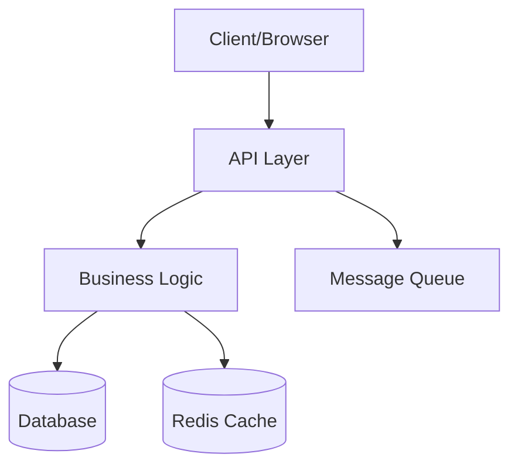

# Codebase Summarizer

Generate comprehensive architecture documentation from repository analysis.

## Core Workflow

1. **Scan structure**: Recursively analyze folder tree and file organization
2. **Identify patterns**: Detect framework, architecture style, key directories
3. **Map entry points**: Find main files, routes, APIs, CLI commands
4. **Trace data flow**: Follow requests through layers (controllers → services → models)
5. **Document modules**: Explain purpose and responsibilities of each directory
6. **Create navigation**: Build "how to" guides for common tasks
7. **Generate diagrams**: Add Mermaid diagrams for visual architecture

## Documentation Structure

### ARCHITECTURE.md Template

````markdown
# Architecture Overview

## System Summary

[Project Name] is a [type] application built with [stack]. It follows [architecture pattern] and handles [primary use cases].

**Tech Stack:**

- Frontend: [framework + key libraries]
- Backend: [framework + key libraries]
- Database: [database + ORM]
- Infrastructure: [hosting + CI/CD]

## High-Level Architecture


````

## Project Structure

```
src/
├── app/              # Application entry point and routing
├── components/       # Reusable UI components
├── lib/              # Utility functions and helpers
├── services/         # Business logic layer
├── models/           # Data models and schemas
└── types/            # TypeScript type definitions
```

## Key Components

### Entry Points

**Main Application:** `src/app/page.tsx`

- Application entry point
- Initializes providers and routing
- Handles global error boundaries

**API Routes:** `src/app/api/`

- RESTful API endpoints
- Authentication middleware
- Request validation

### Core Modules

**Authentication (`src/services/auth/`)**

- User login and registration
- JWT token management
- OAuth2 integration
- Dependencies: bcrypt, jsonwebtoken

**User Management (`src/services/users/`)**

- CRUD operations for users
- Profile management
- Role-based access control
- Dependencies: Prisma, validation libraries

**Data Layer (`src/models/`)**

- Database schemas
- Prisma models
- Query builders
- Dependencies: Prisma Client


## Reference Documentation

- [Implementation Guide](references/implementation-guide.md)

