# Mermaid Diagram Generator - Implementation Guide & Code Recipes

## Sequence Diagrams

### API Request Flow

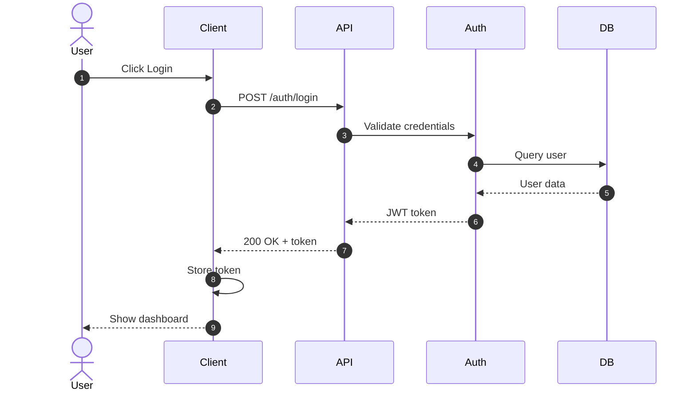

### With Loops and Conditions

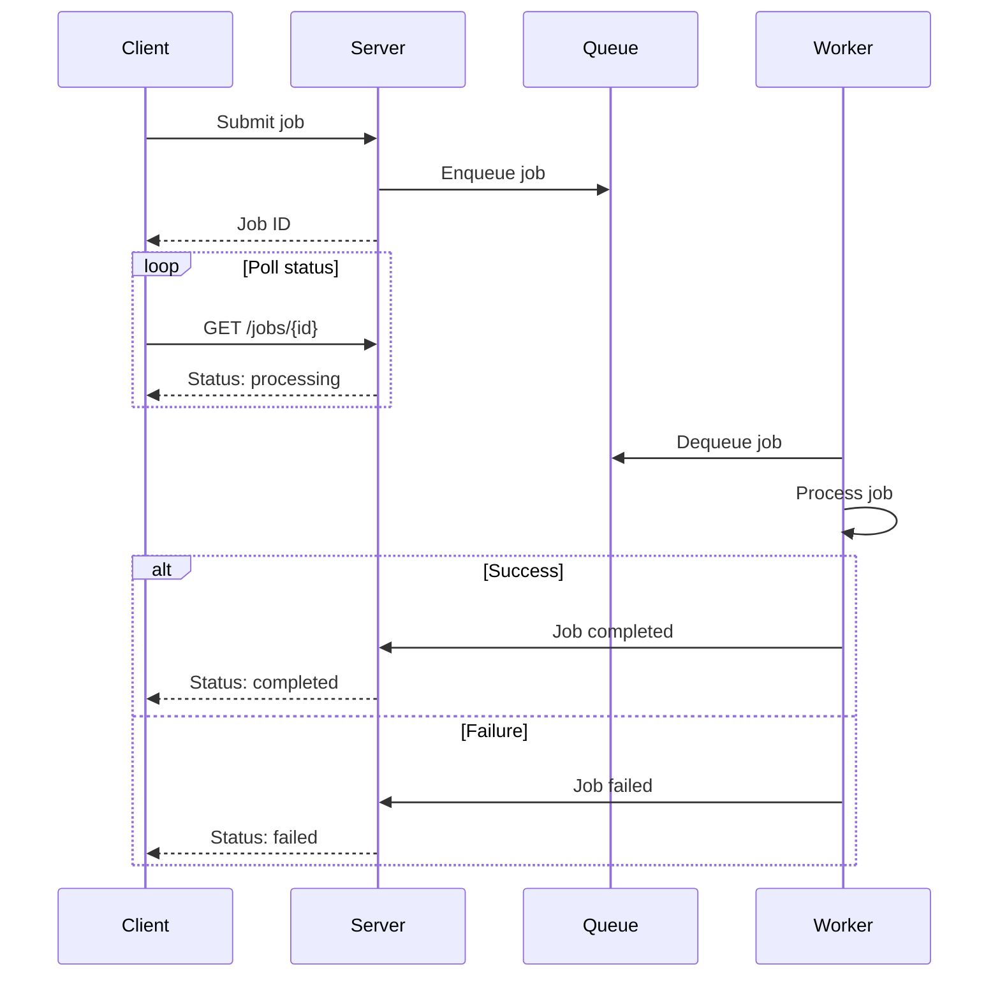

### With Notes and Activations

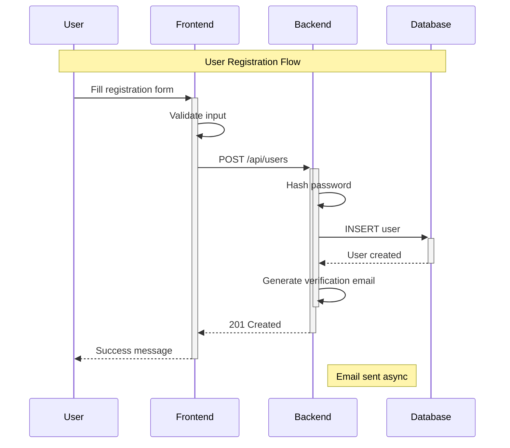

## Entity Relationship Diagrams

### Database Schema

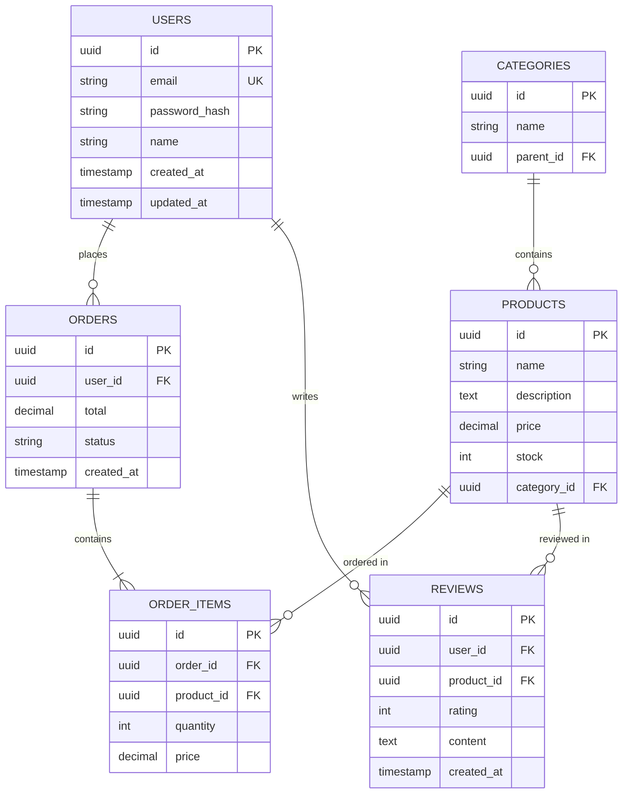

## State Diagrams

### Order State Machine

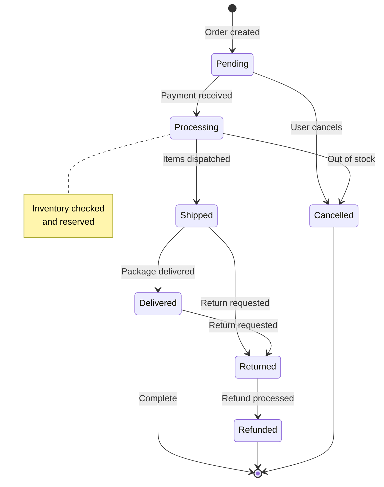

### With Composite States

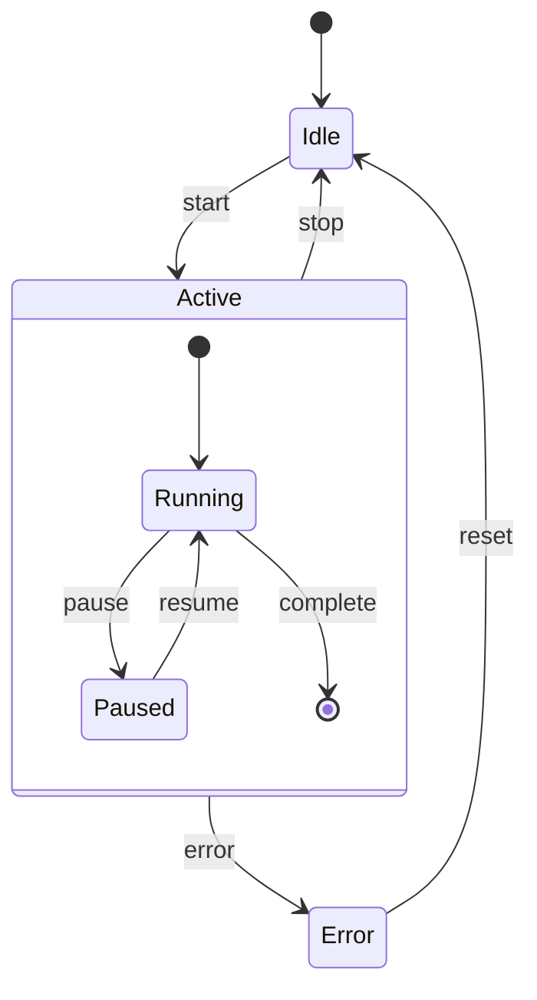

## Class Diagrams

### TypeScript Classes

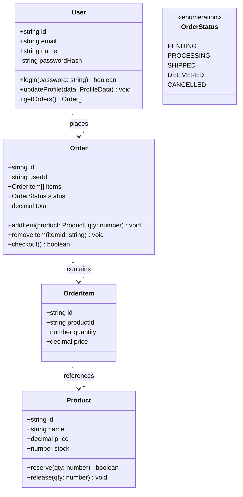

## Architecture Diagrams

### C4 Context Diagram

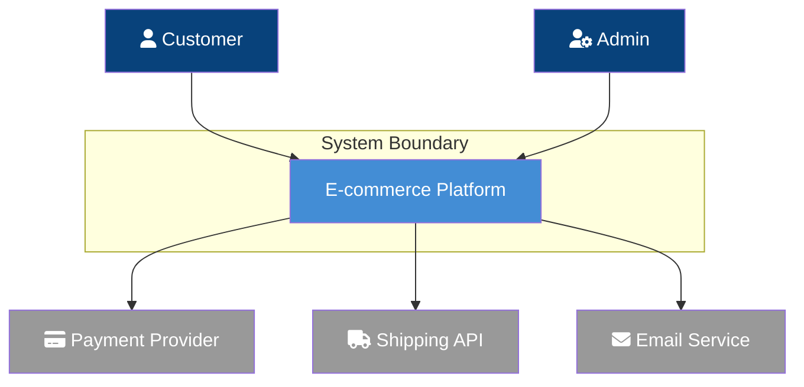

### Microservices Architecture

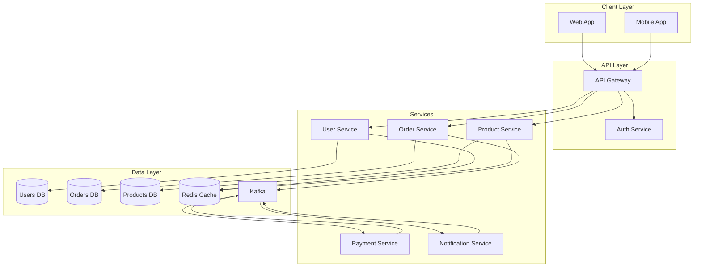

## Git Graph

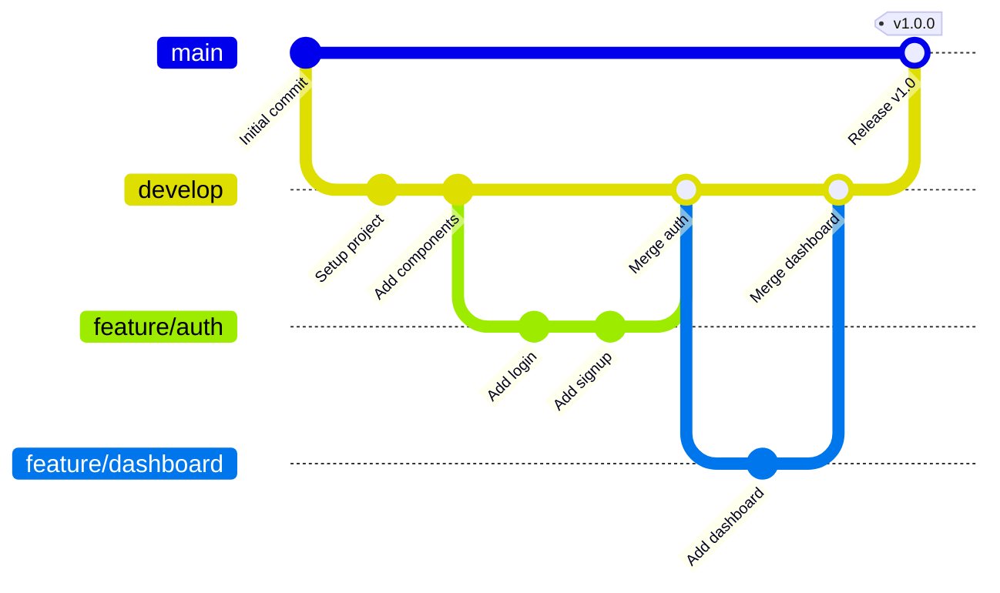

## Pie Charts

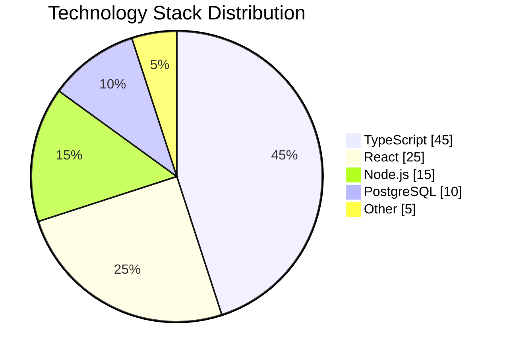

## Timeline

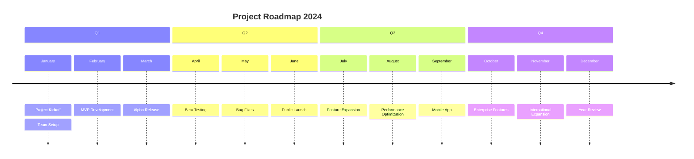

## Mindmap

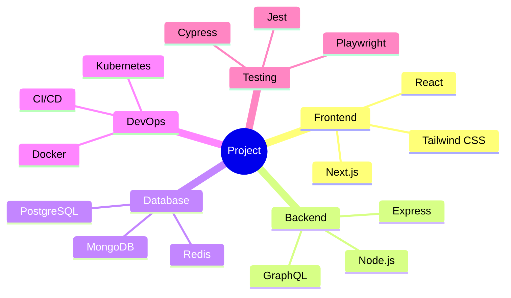
